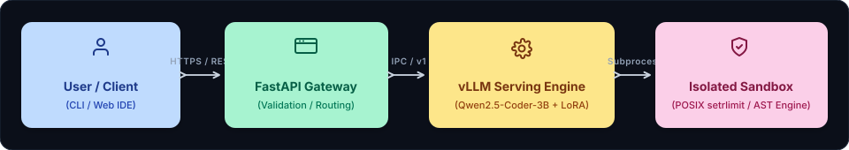
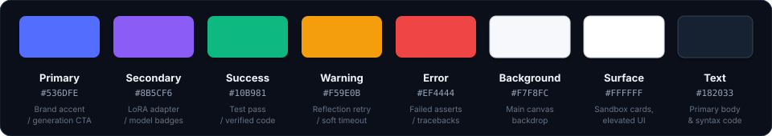

<div align="center">


<br/>

<a href="#benchmark-results">
  
</a>
&nbsp;
<a href="#key-capabilities">
  
</a>
&nbsp;
<a href="#system-architecture">
  
</a>
&nbsp;
<a href="#production-stack">
  
</a>

</div>

<br/>

An end-to-end, production-ready autonomous software engineering system powered by **Qwen2.5-Coder-3B-Instruct** fine-tuned via Low-Rank Adaptation (LoRA). 

The engine couples generative code intelligence with an automated execution sandbox and a self-correction reflection loop. Generated code is dynamically executed against deterministic test assertions. If execution yields an error, the system intercepts the execution traceback, reflects on the failure, and autonomously patches the code until 100% of test assertions pass.

---

## System Architecture

<p align="center" style="margin: 20px 0;">
  
</p>

* **User / Client (CLI / Web IDE)**: Submits problem statement and target test assertions over REST.
* **FastAPI Gateway**: Handles payload validation, function signature normalization, and routing.
* **vLLM Serving Engine**: High-throughput continuous batching inference serving `Qwen2.5-Coder-3B` with LoRA adapter v3.
* **Isolated Sandbox**: POSIX `setrlimit` container throttling compute (5s CPU, 256MB RAM, 1 PID, 64 FDs) and driving the closed self-correction loop.

---

## Benchmark Results

<table width="100%">
  <thead>
    <tr align="left">
      <th>Evaluation Metric</th>
      <th>Benchmark Score</th>
      <th>Verification Status</th>
    </tr>
  </thead>
  <tbody>
    <tr>
      <td><b>MBPP Benchmark Pass Rate (43 Problems)</b></td>
      <td><code>100.0% (43 / 43 PASS)</code></td>
      <td><span style="color: #10B981; font-weight: bold;">Verified</span></td>
    </tr>
    <tr>
      <td><b>Algorithmic Domain Generalization (10 Types)</b></td>
      <td><code>100.0% (10 / 10 PASS)</code></td>
      <td><span style="color: #10B981; font-weight: bold;">Verified</span></td>
    </tr>
    <tr>
      <td><b>First-Pass Success Rate (Round 0)</b></td>
      <td><code>&gt; 90.0%</code></td>
      <td><span style="color: #10B981; font-weight: bold;">Verified</span></td>
    </tr>
    <tr>
      <td><b>Self-Correction Recovery Rate</b></td>
      <td><code>100.0%</code></td>
      <td><span style="color: #10B981; font-weight: bold;">Verified</span></td>
    </tr>
    <tr>
      <td><b>Average Generation Latency</b></td>
      <td><code>&lt; 6.5s per problem</code></td>
      <td><span style="color: #10B981; font-weight: bold;">vLLM PagedAttention</span></td>
    </tr>
  </tbody>
</table>

---

## Design System & Telemetry Tokens

<p align="center" style="margin: 20px 0;">
  
</p>

---

## Engineering Documentation Hub

Complete technical specifications and governance guidelines are maintained inside `docs/`:

| Document | Primary Focus & Specifications |
| :-- | :-- |
| **[`docs/PRD.md`](./docs/PRD.md)** | Product Requirements Document: MVP features, problem statement, and goals |
| **[`docs/ARCHITECTURE.md`](./docs/ARCHITECTURE.md)** | System topology, data flow sequence, component layout, and ADRs |
| **[`docs/RULES.md`](./docs/RULES.md)** | Engineering standards, sandbox security rules, and AI collaboration guidelines |
| **[`docs/DESIGN.md`](./docs/DESIGN.md)** | Visual design system, color tokens, typography, and terminal themes |
| **[`docs/TASKS.md`](./docs/TASKS.md)** | Phased implementation roadmap and task completion tracker |
| **[`docs/MEMORY.md`](./docs/MEMORY.md)** | Session continuity log, active release phase, and operational guardrails |

---

## Repository Structure

```text
Qwen/
├── docs/                               # Engineering documentation suite
│   ├── architecture.svg                # Vector architecture flow diagram
│   ├── palette.svg                     # Vector color palette swatch tokens
│   ├── tasks_dashboard.svg             # Vector tasks metric dashboard
│   ├── memory_status.svg               # Vector session health dashboard
│   ├── PRD.md                          # Product requirements document
│   ├── ARCHITECTURE.md                 # System architecture & ADRs
│   ├── RULES.md                        # Coding standards & collaboration rules
│   ├── DESIGN.md                       # Design system & tokens
│   ├── TASKS.md                        # Task breakdown & progress tracker
│   └── MEMORY.md                       # Operational context & session memory
├── qwen2.5-3b-coder-lora-v3/           # Trained LoRA adapter weights & tokenizer
├── app.py                              # FastAPI production REST gateway service
├── mbpp_harness_fix.py                 # Sandboxed execution runner & reflection harness
├── quen-ai.ipynb                       # End-to-end training, loss analysis & eval notebook
├── Dockerfile                          # Production container image specification
├── docker-compose.yml                  # Orchestrated stack (vLLM + FastAPI API)
├── requirements.txt                    # Locked production Python dependencies
└── README.md                           # Project homepage & documentation index
```

---

## Quick Start

### 1. Interactive Notebook Execution
Open `quen-ai.ipynb` in any JupyterLab or GPU-enabled environment. Run the interactive testing cell at the bottom to synthesize and verify code for any algorithmic prompt.

### 2. Containerized Serving Stack (vLLM + FastAPI)
```bash
# Clone the repository
git clone https://github.com/abhishek4643/QUEN-AI.git
cd QUEN-AI

# Build and start services
docker compose up --build
```
Interactive OpenAPI documentation is accessible at: `http://localhost:8080/docs`

---

## API Endpoints

* `POST /generate`: Fast zero-shot code synthesis.
* `POST /evaluate`: Executes code against assertions in the isolated POSIX sandbox.
* `POST /solve`: Complete end-to-end pipeline: generation, sandbox execution, and autonomous reflection loop.

---

<div align="center">


</div>
