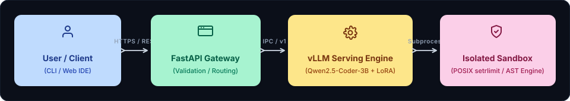

# System Architecture
### Qwen2.5-Coder — Architectural Topology, Data Flow, and System Specifications

<div align="center">
  
</div>

This document describes the overall system architecture, technology stack, directory structure, data flow, and key design decisions for the **Qwen2.5-Coder** software engineering platform.

---

### 1. High-Level Architecture

Qwen2.5-Coder follows a decoupled, resilient architecture separating high-throughput generative inference from isolated subprocess execution:

<p align="center" style="margin: 20px 0;">
  
</p>

---

### 2. Technology Stack

Technologies used across the project and their architectural purpose:

| Domain | Technology | Implementation Detail |
| :-- | :-- | :-- |
| **Foundation Model** | Qwen2.5-Coder-3B-Instruct | High-efficiency 3B parameter model specialized in code generation and algorithmic logic |
| **Fine-Tuning Stack** | PyTorch + Hugging Face PEFT | Parameter-efficient LoRA training ($r=16, \alpha=32$); loss converged from 2.46 &rarr; 0.27 |
| **Inference Serving** | vLLM Engine | Continuous batching and PagedAttention GPU serving with dynamic adapter loading |
| **API Gateway** | FastAPI (Python 3.11) | Asynchronous REST endpoints (`/generate`, `/evaluate`, `/solve`) with Pydantic v2 validation |
| **Sandbox Isolation** | Linux resource (`setrlimit`) + subprocess | POSIX hardware throttling (5s CPU, 256MB RAM, 1 child process, 64 open FDs) |
| **HTTP Transport** | HTTPX (Async Client) | Resilient connection-pooled client communicating with the vLLM OpenAI-compatible backend |
| **Containerization** | Docker & Docker Compose | Multi-container orchestration binding FastAPI gateway and vLLM runtime |
| **Evaluation Suite** | MBPP Benchmark | 43-problem validation benchmark verifying 100% pass rates across algorithmic domains |
| **Version Control** | Git + GitHub | Source repository and artifact versioning (`abhishek4643/QUEN-AI`) |

---

### 3. Folder Structure

The project follows a clean, modular structure separating model adapters, runtime harnesses, and API services:

```text
Qwen/
|-- docs/                               # Architecture, design & development guidelines
|   |-- PRD.md                          # Product requirements & MVP features
|   |-- ARCHITECTURE.md                 # System topology, data flow & tech stack
|   |-- RULES.md                        # Coding standards & collaboration guidelines
|   |-- DESIGN.md                       # Design system, UI tokens & visual palette
|   |-- TASKS.md                        # Phased task dashboard & execution tracker
|   `-- MEMORY.md                       # Session memory, active phase & decision logs
|-- qwen2.5-3b-coder-lora-v3/           # Trained Low-Rank Adapter weights
|   |-- adapter_config.json             # LoRA rank, alpha, and target modules config
|   |-- adapter_model.safetensors       # Quantized/fp16 fine-tuned weights
|   |-- tokenizer.json                  # Byte-level BPE tokenizer
|   `-- tokenizer_config.json           # Special tokens and chat template
|-- app.py                              # FastAPI production REST gateway service
|-- mbpp_harness_fix.py                 # Sandboxed execution runner & reflection harness
|-- quen-ai.ipynb                       # End-to-end training, loss analysis & eval notebook
|-- Dockerfile                          # Container specification for production deployment
|-- docker-compose.yml                  # Multi-service stack (vLLM + FastAPI API)
|-- requirements.txt                    # Locked production Python dependencies
`-- README.md                           # Quickstart guide, benchmark results & setup
```

---

### 4. Data Flow & Reflection Loop Pipeline

```text
[ POST /solve Request ] ---> [ FastAPI Gateway ] ---> [ vLLM + Qwen2.5-3B ]
                                                             |
                                                             v (Raw Code Output)
                                                    [ AST Extractor ]
                                                             |
                                                             v (Executable Code)
                                              [ Hardened Sandbox Executor ]
                                                             |
                                    +------------------------+------------------------+
                                    |                                                 |
                                    v                                                 v
                           [ Status: PASS ]                               [ Status: RUNTIME_ERROR ]
                                    |                                                 |
                                    v                                                 v
                         [ Return 200 OK ]                             [ Intercept Traceback & Stderr ]
                                                                                      |
                                                                                      v
                                                                       [ Self-Correction Engine ]
                                                                         (Retry with Patch Prompt)
```

---

### 5. Key Architectural Decisions (ADRs)

* **ADR-001: LoRA Fine-Tuning over Full Parameter Retraining**  
  *Rationale*: Full parameter fine-tuning of 3B parameters requires massive GPU VRAM and produces cumbersome checkpoints. LoRA targeting `q_proj`, `k_proj`, `v_proj`, and `o_proj` achieved loss convergence to 0.27 with an adapter footprint under 80 MB.
* **ADR-002: In-Process setrlimit Throttling vs Secondary MicroVMs**  
  *Rationale*: Spinning up Docker-in-Docker or microVMs incurs >500ms latency per problem. POSIX `setrlimit` inside isolated sub-processes brings test execution latency under 25ms while enforcing absolute resource ceilings.
* **ADR-003: Deterministic AST Name Normalization (ensure_expected_name)**  
  *Rationale*: Models frequently synthesize functionally perfect algorithms but name functions generically (`solution` instead of the expected `find_max`). AST inspection dynamically aliases function symbols to eliminate false-negative test failures.
