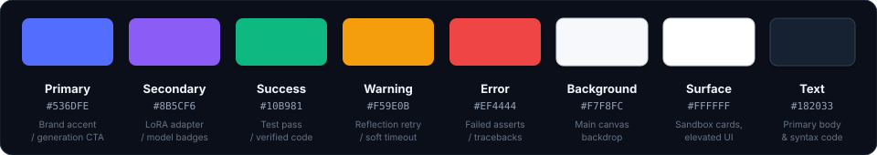

# Design System
### Qwen2.5-Coder — Clean. Simple. Productive.

<div align="center">
  
</div>

This document defines the visual design system: UI components, design tokens, and user experience guidelines for the **Qwen2.5-Coder** software engineering system. The goal is to establish a modern, minimal, developer-friendly interface with consistent styling across terminal outputs, interactive notebooks, and web dashboards.

---

### 1. Design Principles

<table width="100%" cellpadding="0" cellspacing="8" border="0">
  <tr>
    <td width="25%" style="background-color: #0D1117; border: 1px solid #30363D; border-radius: 8px; padding: 18px 14px;">
      <div style="color: #818CF8; font-weight: 700; font-size: 13px; text-transform: uppercase; letter-spacing: 0.04em;">User-Centered</div>
      <div style="color: #8B949E; font-size: 12px; margin-top: 6px; line-height: 1.5;">Simple and intuitive for developers; instant error tracebacks and one-click execution.</div>
    </td>
    <td width="25%" style="background-color: #0D1117; border: 1px solid #30363D; border-radius: 8px; padding: 18px 14px;">
      <div style="color: #34D399; font-weight: 700; font-size: 13px; text-transform: uppercase; letter-spacing: 0.04em;">Minimal & Clean</div>
      <div style="color: #8B949E; font-size: 12px; margin-top: 6px; line-height: 1.5;">Reduce clutter and focus strictly on code diffs, test assertions, and runtime states.</div>
    </td>
    <td width="25%" style="background-color: #0D1117; border: 1px solid #30363D; border-radius: 8px; padding: 18px 14px;">
      <div style="color: #EC4899; font-weight: 700; font-size: 13px; text-transform: uppercase; letter-spacing: 0.04em;">Consistent</div>
      <div style="color: #8B949E; font-size: 12px; margin-top: 6px; line-height: 1.5;">Follow a unified design system across terminal logs, notebooks, and web dashboards.</div>
    </td>
    <td width="25%" style="background-color: #0D1117; border: 1px solid #30363D; border-radius: 8px; padding: 18px 14px;">
      <div style="color: #38BDF8; font-weight: 700; font-size: 13px; text-transform: uppercase; letter-spacing: 0.04em;">Accessible</div>
      <div style="color: #8B949E; font-size: 12px; margin-top: 6px; line-height: 1.5;">Usable for everyone; high-contrast syntax highlighting conforming to WCAG 2.1 AA.</div>
    </td>
  </tr>
</table>

---

### 2. Color Palette
*Primary colors used across the application and telemetry interfaces:*

<p align="center" style="margin: 20px 0;">
  
</p>

<table width="100%" cellpadding="0" cellspacing="6" border="0" style="font-family: 'Inter', -apple-system, BlinkMacSystemFont, sans-serif;">
  <tr align="center" valign="top">
    <td bgcolor="#536DFE" width="12.5%" style="background-color: #536DFE; color: #FFFFFF; border-radius: 8px; padding: 16px 8px; box-shadow: 0 4px 6px -1px rgba(83, 109, 254, 0.3);">
      <b style="color: #FFFFFF; font-size: 13px;">Primary</b><br>
      <code style="color: #FFFFFF; font-size: 11px;">#536DFE</code><br>
      <span style="color: #E0E7FF; font-size: 10px;">Brand CTA</span>
    </td>
    <td bgcolor="#8B5CF6" width="12.5%" style="background-color: #8B5CF6; color: #FFFFFF; border-radius: 8px; padding: 16px 8px; box-shadow: 0 4px 6px -1px rgba(139, 92, 246, 0.3);">
      <b style="color: #FFFFFF; font-size: 13px;">Secondary</b><br>
      <code style="color: #FFFFFF; font-size: 11px;">#8B5CF6</code><br>
      <span style="color: #EDE9FE; font-size: 10px;">LoRA / Badges</span>
    </td>
    <td bgcolor="#10B981" width="12.5%" style="background-color: #10B981; color: #FFFFFF; border-radius: 8px; padding: 16px 8px; box-shadow: 0 4px 6px -1px rgba(16, 185, 129, 0.3);">
      <b style="color: #FFFFFF; font-size: 13px;">Success</b><br>
      <code style="color: #FFFFFF; font-size: 11px;">#10B981</code><br>
      <span style="color: #D1FAE5; font-size: 10px;">Pass Verdict</span>
    </td>
    <td bgcolor="#F59E0B" width="12.5%" style="background-color: #F59E0B; color: #FFFFFF; border-radius: 8px; padding: 16px 8px; box-shadow: 0 4px 6px -1px rgba(245, 158, 11, 0.3);">
      <b style="color: #FFFFFF; font-size: 13px;">Warning</b><br>
      <code style="color: #FFFFFF; font-size: 11px;">#F59E0B</code><br>
      <span style="color: #FEF3C7; font-size: 10px;">Retries / Alert</span>
    </td>
    <td bgcolor="#EF4444" width="12.5%" style="background-color: #EF4444; color: #FFFFFF; border-radius: 8px; padding: 16px 8px; box-shadow: 0 4px 6px -1px rgba(239, 68, 68, 0.3);">
      <b style="color: #FFFFFF; font-size: 13px;">Error</b><br>
      <code style="color: #FFFFFF; font-size: 11px;">#EF4444</code><br>
      <span style="color: #FEE2E2; font-size: 10px;">Traceback</span>
    </td>
    <td bgcolor="#F7F8FC" width="12.5%" style="background-color: #F7F8FC; color: #182033; border: 1px solid #CBD5E1; border-radius: 8px; padding: 16px 8px; box-shadow: 0 2px 4px rgba(0,0,0,0.1);">
      <b style="color: #182033; font-size: 13px;">Background</b><br>
      <code style="color: #475569; font-size: 11px;">#F7F8FC</code><br>
      <span style="color: #64748B; font-size: 10px;">Light Canvas</span>
    </td>
    <td bgcolor="#FFFFFF" width="12.5%" style="background-color: #FFFFFF; color: #182033; border: 1px solid #CBD5E1; border-radius: 8px; padding: 16px 8px; box-shadow: 0 2px 4px rgba(0,0,0,0.1);">
      <b style="color: #182033; font-size: 13px;">Surface</b><br>
      <code style="color: #475569; font-size: 11px;">#FFFFFF</code><br>
      <span style="color: #64748B; font-size: 10px;">Cards / UI</span>
    </td>
    <td bgcolor="#182033" width="12.5%" style="background-color: #182033; color: #FFFFFF; border: 1px solid #334155; border-radius: 8px; padding: 16px 8px; box-shadow: 0 4px 6px -1px rgba(24, 32, 51, 0.4);">
      <b style="color: #FFFFFF; font-size: 13px;">Text</b><br>
      <code style="color: #94A3B8; font-size: 11px;">#182033</code><br>
      <span style="color: #94A3B8; font-size: 10px;">Dark Slate</span>
    </td>
  </tr>
</table>

---

### 3. Typography
*We use Inter as the primary interface font and JetBrains Mono for code telemetry:*

<div style="background-color: #0D1117; border: 1px solid #30363D; border-radius: 8px; padding: 18px 20px; margin: 14px 0;">
  <table width="100%" cellpadding="0" cellspacing="0" border="0">
    <tr>
      <td width="90" align="center" style="font-size: 40px; font-weight: 800; background-color: #161B22; color: #818CF8; border: 1px solid #30363D; border-radius: 8px; padding: 8px 12px;">Aa</td>
      <td style="padding-left: 20px;">
        <div style="font-size: 18px; font-weight: 700; color: #F0F6FC;">Inter & JetBrains Mono</div>
        <div style="color: #818CF8; font-size: 12px; font-weight: 600; margin-top: 2px;">Primary font family</div>
        <div style="color: #8B949E; font-size: 12px; margin-top: 4px;">Clean, modern, and highly legible across code diffs, logs, and technical specifications.</div>
      </td>
    </tr>
  </table>
</div>

| Element | Font Family | Size | Weight | Line Height |
| :-- | :-- | :-: | :-: | :-: |
| **Heading 1 (H1)** | Inter | 24px (1.5rem) | 700 Bold | 1.3 |
| **Heading 2 (H2)** | Inter | 18px (1.125rem) | 600 Semi-Bold | 1.4 |
| **Heading 3 (H3)** | Inter | 14px (0.875rem) | 600 Semi-Bold | 1.4 |
| **Body Text** | Inter | 13px (0.8125rem) | 400 Regular | 1.6 |
| **Code & Stack Traces** | JetBrains Mono | 12px (0.75rem) | 400 Regular / 600 Bold | 1.6 |
| **Status Badges & Pills** | Inter | 11px (0.6875rem) | 600 Semi-Bold | 1.2 |

---

### 4. UI Components
*Standard components matching Abhishek's profile design standards:*

#### Buttons
<div style="margin: 12px 0;">
  <a href="#" style="background-color: #4F46E5; color: #FFFFFF; border-radius: 6px; padding: 8px 18px; font-size: 12px; font-weight: 600; text-decoration: none; display: inline-block; margin-right: 8px;">Primary Action</a>
  <a href="#" style="background-color: #161B22; color: #C9D1D9; border: 1px solid #30363D; border-radius: 6px; padding: 8px 18px; font-size: 12px; font-weight: 600; text-decoration: none; display: inline-block; margin-right: 8px;">Secondary Action</a>
  <a href="#" style="background-color: #EA4335; color: #FFFFFF; border-radius: 6px; padding: 8px 18px; font-size: 12px; font-weight: 600; text-decoration: none; display: inline-block;">Destructive Action</a>
</div>

#### Status Badges (Shields & Pills)
<div style="margin: 12px 0;">
  
  &nbsp;
  
  &nbsp;
  
  &nbsp;
  
</div>

#### Terminal Execution Card
```text
+---------------------------------------------------------------------------------+
|  Qwen2.5-Coder Sandbox Telemetry                             [ PASS (0.42s) ]   |
+---------------------------------------------------------------------------------+
|  Problem: "Write a function to find maximum subarray sum (Kadane's Algo)"       |
|  Function Name: max_sub_array_sum                                               |
|                                                                                 |
|  >>> Code Implementation:                                                       |
|  1 | def max_sub_array_sum(arr):                                                |
|  2 |     max_so_far = current_max = arr[0]                                      |
|  3 |     for x in arr[1:]:                                                      |
|  4 |         current_max = max(x, current_max + x)                              |
|  5 |         max_so_far = max(max_so_far, current_max)                          |
|  6 |     return max_so_far                                                      |
|                                                                                 |
|  >>> Test Suite Assertions:                                                     |
|  [OK] assert max_sub_array_sum([-2, 1, -3, 4, -1, 2, 1, -5, 4]) == 6             |
|  [OK] assert max_sub_array_sum([1]) == 1                                         |
|  [OK] assert max_sub_array_sum([5, 4, -1, 7, 8]) == 23                          |
+---------------------------------------------------------------------------------+
```
